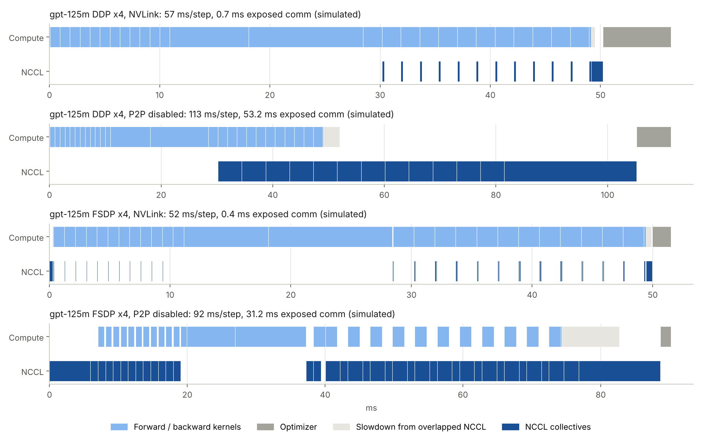
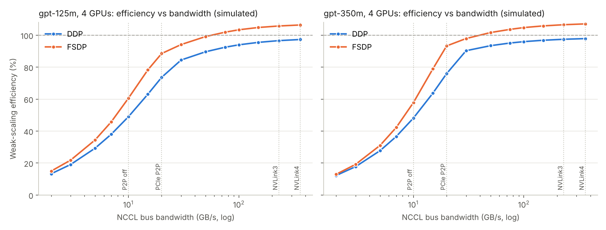
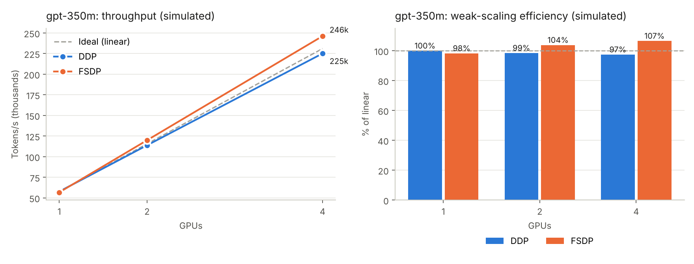
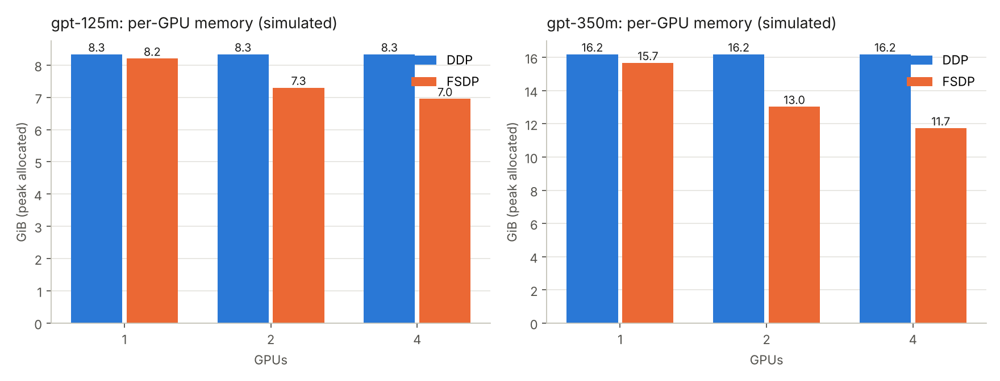
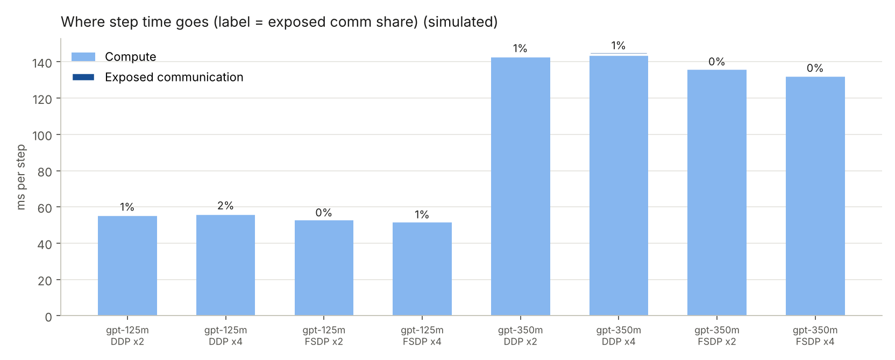
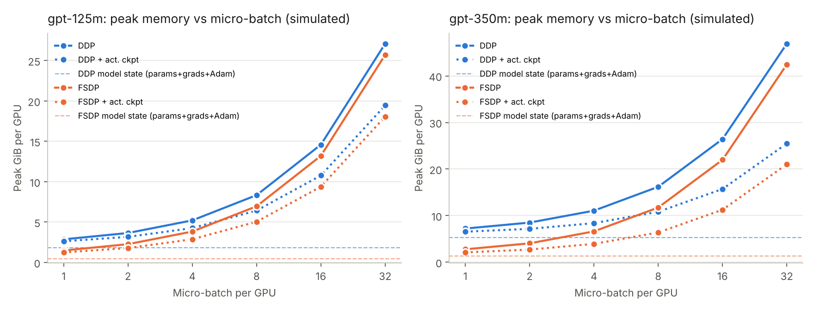

# Distributed LLM Training: How Efficiently Does Training Scale Across GPUs?

A GPT-style language model (125M and 350M parameters, up to 20B for the memory study) trained with
**PyTorch DDP** and **FSDP2** on 1, 2 and 4 GPUs, plus an **event-driven performance simulator** of
the same code, to answer two questions:

1. **How efficiently does throughput scale** as GPUs are added?
2. **What limits it?** Communication vs compute, memory vs model size.

Every result in this repository carries one of two labels:

- **Measured:** produced by running `train.py` on real hardware.
- **Simulated:** produced by `dlt/simulator.py`, which is calibrated on one published GPU measurement and checked against others.

<!-- HEADLINE_SIM:START -->
> **Simulated:** 97% weak-scaling efficiency on 4 GPUs (DDP, gpt-350m), with FSDP at 1.09x DDP's throughput; FSDP cut per-GPU memory 27%, enabling 3.0x larger models (gpt-4b -> gpt-13b).
<!-- HEADLINE_SIM:END -->
<!-- HEADLINE:START -->
> **Measured (GPU):** pending. Run `slurm/sol_scaling.sbatch` (4x A100) or `scripts/kaggle_2xT4.sh` (free 2x T4).
<!-- HEADLINE:END -->

| Result | Status |
|---|---|
| DDP / FSDP numerical equivalence with single-process training | **Measured** (CPU) |
| Per-rank model-state memory under DDP and FSDP | **Measured** (CPU), matches the simulator byte for byte |
| Throughput, scaling efficiency, MFU, communication overlap | **Simulated** (4x A100-SXM4-80GB); GPU measurement pending |
| Peak GPU memory, activation crossover, largest trainable model | **Simulated**; GPU measurement pending |
| NVLink vs no-P2P, tied-embedding bottleneck, bf16 gradient comm | **Simulated**; GPU measurement pending |

---

## What's here

```
train.py                  one entry point: --strategy single | ddp | fsdp
dlt/model.py              GPT-2-architecture model, sizes 125M to 20B, exact param/FLOP counts
dlt/distributed.py        process groups, DDP (+ bf16 gradient comm hook), FSDP2 (+ meta-device init)
dlt/data.py               deterministic global-batch sampler (real tokens or synthetic)
dlt/simulator.py          event-driven simulator: kernel roofline + NCCL alpha-beta + stream timelines + memory
bench/simulate.py         calibrate, validate, simulate the whole study, extra experiments, sim-vs-measured
bench/measure_cpu.py      the Measured (CPU) results: equivalence + per-rank model state
bench/run_scaling.sh      GPU sweep: strategies x GPU counts x models (weak, strong, comm, no-P2P runs)
bench/memory_sweep.sh     GPU peak memory vs micro-batch, with/without activation checkpointing
bench/find_max_model.py   largest model each strategy can train on the GPUs at hand
bench/analyze.py          tables, plots, findings, headline (--mode measured | simulated)
scripts/kaggle_2xT4.sh    free measured run on Kaggle 2x T4
slurm/sol_scaling.sbatch  one-shot 4-GPU job (ASU Sol)
tests/                    CPU correctness tests
```

## Design decisions

| Decision | Why |
|---|---|
| **Single-GPU baseline is a plain model**, not DDP on 1 GPU | DDP x1 and FSDP x1 are also run, so framework overhead shows up separately from scaling loss. |
| **Deterministic global batch** (every rank builds the same global batch, keeps its slice) | N GPUs x micro-batch B is *the same training run* as 1 GPU x N·B, so equivalence can be tested exactly. |
| **FSDP2 (`fully_shard`)**, one unit per transformer block, optional **meta-device init** | Only one block's full weights exist at a time, and with `--meta-init` no rank ever materializes the whole model, which the max-model experiment needs. |
| **bf16 mixed precision** (fp16 + loss scaling on T4) with fp32 gradient reduction | Standard for LLM training; same numerics for both strategies. |
| **Slowest-rank median step time** | Every step waits for the slowest rank, so that is the honest throughput. |
| **Compute-only runs** (`--no-grad-sync`) + **profiler pass** | Full minus compute-only step = *exposed* communication; the profiler gives total NCCL time, so the hidden share is measurable. |
| **Simulator replays each strategy's real schedule** instead of assuming an MFU | Efficiency, overlap and memory come out of the mechanism, so the simulator can be *wrong in an informative way* once measured numbers exist. |

## Metrics

| Metric | Definition |
|---|---|
| Weak-scaling efficiency | `tok/s(N) / (N × tok/s(single GPU))` at a fixed per-GPU batch. Can exceed 100% if a strategy does *less* work per GPU than the baseline (see Discussion). |
| Strong-scaling speedup | `step_time(single, G) / step_time(N, G)` at a fixed global batch G |
| Exposed communication | `full_step − compute_only_step` |
| Hidden communication | `1 − exposed / total NCCL kernel time` |
| MFU | model FLOPs/s per GPU ÷ dense peak (6N + attention, PaLM-style) |
| Per-GPU memory reduction | `1 − peak_mem(FSDP, N) / peak_mem(DDP, N)` |
| Max-model ratio | params of the largest model FSDP trains ÷ largest DDP trains, micro-batch 1 |

---

## Simulated results

<!-- SIMULATOR:START -->
Simulator: [`dlt/simulator.py`](dlt/simulator.py), full method, calibration and experiments in [`results/simulated/SIMULATOR.md`](results/simulated/SIMULATOR.md).

**Calibration and validation** (published measurements by others vs this simulator):

| Setup | Measured (published) | Simulated | Error |
|---|---|---|---|
| GPT-2 124M, 1x H100, PyTorch (MFU, calibration) | 36.0% | 36.0% | +0.0 pts |
| GPT-2 124M, 8x H100 DDP, PyTorch (MFU, validation) | 33.0% | 35.1% | +2.1 pts |
| GPT-2 124M, 1x to 8x H100 DDP scaling efficiency (33% / 36% MFU) (efficiency, validation) | 91.7% | 97.4% | +5.8 pts |
| GPT-2 1.5B, 8x H100 DDP, PyTorch (micro-batch not reported; 8 x16 accum assumed) (MFU, validation) | 41.9% | 47.1% | +5.2 pts |
| GPT-2 124M, 1x A100 40GB PCIe, llm.c (hand-fused CUDA, fp16): simulated eager PyTorch should be lower (MFU, bound) | 49.0% | 42.0% | -7.0 pts |

**Simulated: the tied-embedding bottleneck.** For gpt-125m, the embedding matrix is 31% of all parameters and its gradient is the last one ready, so its 147 MB all-reduce is always exposed: 1.0 ms on NVLink, but 24 ms with P2P disabled (45% of all exposed communication). bf16 gradient communication lifts simulated efficiency there from 49% to 74%.

**Simulated: largest trainable model on 4x A100-SXM4-80GB:** DDP gpt-4b, FSDP gpt-13b (3.0x).



<!-- SIMULATOR:END -->

<!-- RESULTS_SIM:START -->
**Simulated:** 97% weak-scaling efficiency on 4 GPUs (DDP, gpt-350m), with FSDP at 1.09x DDP's throughput; FSDP cut per-GPU memory 27%, enabling 3.0x larger models (gpt-4b -> gpt-13b).

### Key findings (simulated)

- **gpt-125m, 4 GPUs:** DDP reached 97% weak-scaling efficiency vs 106% for FSDP (FSDP delivered 9% more throughput than DDP). Exposed communication was 1.1 ms/step for DDP vs 0.3 ms/step for FSDP; DDP hid 68% of its NCCL time behind compute, FSDP 92%.
- **gpt-350m, 4 GPUs:** DDP reached 97% weak-scaling efficiency vs 107% for FSDP (FSDP delivered 9% more throughput than DDP). Exposed communication was 1.5 ms/step for DDP vs 0.7 ms/step for FSDP; DDP hid 84% of its NCCL time behind compute, FSDP 93%.
- **Interconnect (gpt-125m, DDP x4):** disabling NVLink/P2P dropped efficiency from 97% to 49% (1.97x slower).
- **Interconnect (gpt-125m, FSDP x4):** disabling NVLink/P2P dropped efficiency from 106% to 60% (1.75x slower).
- **Interconnect (gpt-350m, DDP x4):** disabling NVLink/P2P dropped efficiency from 97% to 48% (2.03x slower).
- **Interconnect (gpt-350m, FSDP x4):** disabling NVLink/P2P dropped efficiency from 107% to 58% (1.85x slower).
- **Activation memory (gpt-125m, FSDP x4):** activations exceed sharded model state from micro-batch 1; at micro-batch 32 activations are 98% of peak.
- **Activation memory (gpt-125m, FSDP x4, ckpt):** activations exceed sharded model state from micro-batch 1; at micro-batch 32 activations are 97% of peak.
- **Activation memory (gpt-350m, FSDP x4):** activations exceed sharded model state from micro-batch 1; at micro-batch 32 activations are 97% of peak.
- **Activation memory (gpt-350m, FSDP x4, ckpt):** activations exceed sharded model state from micro-batch 2; at micro-batch 32 activations are 94% of peak.

### Weak scaling (fixed per-GPU batch)

| Model | Strategy | GPUs | Tokens/s | Step (ms) | Efficiency | MFU |
|---|---|---|---|---|---|---|
| gpt-125m | DDP | 1 | 148,030 | 55.3 | 100.0% | 40.6% |
| gpt-125m | DDP | 2 | 289,999 | 56.5 | 97.9% | 39.7% |
| gpt-125m | DDP | 4 | 572,179 | 57.3 | 96.6% | 39.2% |
| gpt-125m | FSDP | 1 | 146,673 | 55.9 | 99.1% | 40.2% |
| gpt-125m | FSDP | 2 | 306,870 | 53.4 | 103.6% | 42.0% |
| gpt-125m | FSDP | 4 | 626,416 | 52.3 | 105.8% | 42.9% |
| gpt-350m | DDP | 1 | 57,755 | 141.8 | 100.0% | 44.9% |
| gpt-350m | DDP | 2 | 113,814 | 144.0 | 98.5% | 44.2% |
| gpt-350m | DDP | 4 | 225,172 | 145.5 | 97.4% | 43.7% |
| gpt-350m | FSDP | 1 | 56,772 | 144.3 | 98.3% | 44.1% |
| gpt-350m | FSDP | 2 | 119,924 | 136.6 | 103.8% | 46.6% |
| gpt-350m | FSDP | 4 | 246,230 | 133.1 | 106.6% | 47.8% |

### Strong scaling (fixed global batch)

| Model | Strategy | GPUs | Speedup | Efficiency |
|---|---|---|---|---|
| gpt-125m | DDP | 1 | 1.00x | 100.0% |
| gpt-125m | DDP | 2 | 1.90x | 95.0% |
| gpt-125m | DDP | 4 | 3.48x | 87.1% |
| gpt-125m | FSDP | 1 | 1.00x | 99.7% |
| gpt-125m | FSDP | 2 | 1.96x | 97.9% |
| gpt-125m | FSDP | 4 | 3.81x | 95.3% |
| gpt-350m | DDP | 1 | 1.00x | 100.0% |
| gpt-350m | DDP | 2 | 1.90x | 95.0% |
| gpt-350m | DDP | 4 | 3.47x | 86.9% |
| gpt-350m | FSDP | 1 | 1.00x | 99.5% |
| gpt-350m | FSDP | 2 | 1.95x | 97.6% |
| gpt-350m | FSDP | 4 | 3.80x | 95.0% |

### Per-GPU memory

| Model | Strategy | GPUs | Simulated peak (GiB) | Model state (GiB) | Theory, 16 B/param (GiB) |
|---|---|---|---|---|---|
| gpt-125m | Single GPU | 1 | 8.02 | 1.85 | 1.85 |
| gpt-125m | DDP | 1 | 8.34 | 1.85 | 1.85 |
| gpt-125m | DDP | 2 | 8.34 | 1.85 | 1.85 |
| gpt-125m | DDP | 4 | 8.34 | 1.85 | 1.85 |
| gpt-125m | FSDP | 1 | 8.21 | 1.85 | 1.85 |
| gpt-125m | FSDP | 2 | 7.30 | 0.93 | 0.93 |
| gpt-125m | FSDP | 4 | 6.95 | 0.46 | 0.46 |
| gpt-350m | Single GPU | 1 | 15.06 | 5.28 | 5.28 |
| gpt-350m | DDP | 1 | 16.19 | 5.28 | 5.28 |
| gpt-350m | DDP | 2 | 16.19 | 5.28 | 5.28 |
| gpt-350m | DDP | 4 | 16.19 | 5.28 | 5.28 |
| gpt-350m | FSDP | 1 | 15.67 | 5.28 | 5.28 |
| gpt-350m | FSDP | 2 | 13.03 | 2.64 | 2.64 |
| gpt-350m | FSDP | 4 | 11.74 | 1.32 | 1.32 |

### Communication: how much is hidden behind backward?

| Model | Strategy | GPUs | Full step (ms) | Compute-only (ms) | Exposed comm | NCCL kernel time (ms) | Hidden |
|---|---|---|---|---|---|---|---|
| gpt-125m | DDP | 2 | 56.5 | 55.8 | 1.3% | 2.4 | 70% |
| gpt-125m | DDP | 4 | 57.3 | 56.2 | 1.9% | 3.4 | 68% |
| gpt-125m | FSDP | 2 | 53.4 | 53.2 | 0.3% | 2.6 | 94% |
| gpt-125m | FSDP | 4 | 52.3 | 52.0 | 0.5% | 3.6 | 92% |
| gpt-350m | DDP | 2 | 144.0 | 143.0 | 0.7% | 6.5 | 86% |
| gpt-350m | DDP | 4 | 145.5 | 144.0 | 1.1% | 9.6 | 84% |
| gpt-350m | FSDP | 2 | 136.6 | 136.2 | 0.3% | 7.0 | 94% |
| gpt-350m | FSDP | 4 | 133.1 | 132.4 | 0.5% | 10.0 | 93% |

### NVLink vs no-P2P

| Model | Strategy | GPUs | Efficiency (P2P on) | Efficiency (P2P off) | Slowdown |
|---|---|---|---|---|---|
| gpt-125m | DDP | 4 | 97% | 49% | 1.97x |
| gpt-125m | FSDP | 4 | 106% | 60% | 1.75x |
| gpt-350m | DDP | 4 | 97% | 48% | 2.03x |
| gpt-350m | FSDP | 4 | 107% | 58% | 1.85x |

### Where activation memory takes over

| Model | Strategy | GPUs | Act. ckpt | Activations > model state from micro-batch | Activation share at largest batch |
|---|---|---|---|---|---|
| gpt-125m | DDP | 4 | no | 4 | 93% |
| gpt-125m | DDP | 4 | yes | 4 | 90% |
| gpt-125m | FSDP | 4 | no | 1 | 98% |
| gpt-125m | FSDP | 4 | yes | 1 | 97% |
| gpt-350m | DDP | 4 | no | 4 | 89% |
| gpt-350m | DDP | 4 | yes | 8 | 79% |
| gpt-350m | FSDP | 4 | no | 1 | 97% |
| gpt-350m | FSDP | 4 | yes | 2 | 94% |

### Largest trainable model

On 4 GPUs (micro-batch 1): DDP fits **gpt-4b** (4,235M), FSDP fits **gpt-13b** (12,846M), **3.0x** larger.






<!-- RESULTS_SIM:END -->

## Discussion (based on the Simulated results)

Everything in this section is a **simulated** explanation of **simulated** numbers. Each claim names
the mechanism so a GPU run can confirm or refute it.

**1. Why does FSDP beat DDP here, against the usual rule of thumb?** In the simulation the forward and
backward passes cost the same under both strategies (49.1 ms for gpt-125m at micro-batch 8). The
difference is the optimizer: DDP runs AdamW over all 124M parameters on every GPU (6.2 ms of
memory-bound traffic), FSDP over a quarter of them (1.5 ms). For gpt-350m the gap is 17.6 vs 4.4 ms.
That sharded optimizer step, not communication, is why FSDP shows more than 100% weak-scaling
efficiency: each GPU does less work than the single-GPU baseline. The rule of thumb that FSDP is
slower for small models assumes communication dominates; on NVLink it is a few ms per step. What
the simulator does *not* model well is CPU-side overhead (FSDP2 hooks, DTensor dispatch in the
optimizer), so this is the simulated result most worth testing.

**2. How much communication is hidden behind backward?** DDP hides about 68% (125M) to 84% (350M)
of its NCCL time; FSDP about 92 to 93%. FSDP spreads its traffic over the whole step (all-gathers
during forward, reduce-scatters during backward), while DDP's all-reduces can only start once
gradients exist. Total bytes are almost the same: DDP all-reduces 4-byte gradients (2 × 4 B/param),
FSDP all-gathers 2-byte weights twice and reduce-scatters 4-byte gradients (2 + 2 + 4 B/param).

**3. The bottleneck worth knowing about: the tied embedding gradient arrives last.** `wte` is the
first parameter, so DDP puts it in the last bucket, and because it is tied to the LM head its
gradient is only complete after the embedding backward, the final kernel of the backward pass.
Nothing is left to hide its all-reduce behind. For gpt-125m that tensor is 31% of all parameters.
On NVLink it costs about 1 ms per step, nearly all of DDP's exposed communication. With P2P disabled
it costs about 24 ms per step, and halving gradient bytes with `--ddp-bf16-comm` raises simulated
efficiency from 49% to 74%.

**4. What does NVLink buy?** Everything. With P2P disabled (traffic staged through host memory at
about 10 GB/s instead of 230 GB/s), simulated 4-GPU efficiency falls from 97% to 49% for
DDP and from 106% to 60% for FSDP. The bandwidth sweep shows the knee: efficiency only
for DDP drops below 90% once the bus bandwidth falls under roughly 30 to 50 GB/s, so PCIe-only
machines sit on the steep part of the curve. FSDP is somewhat more tolerant because more of its traffic overlaps with
compute, and keeping blocks gathered (`--no-reshard`) recovers another 10 to 15 points on slow links
for under 1 GiB of extra memory.

**5. Where does activation memory take over?** FSDP cuts *model state* by exactly 75% on 4 GPUs
(1.85 → 0.46 GiB for gpt-125m, Measured on CPU and Simulated alike). Peak memory falls much less,
by 17% for gpt-125m and 27% for gpt-350m, because activations are not sharded. For gpt-125m at
micro-batch 8 the vocabulary logits alone (b·s·V·10 bytes = 3.8 GiB) outweigh all 12 transformer
layers' activations (2.4 GiB). Under FSDP, activations exceed the sharded model state from the very
first micro-batch. That is why FSDP's real payoff is model size, not batch size: at micro-batch 1
model state dominates, and FSDP lets 4x A100-80GB train a 12.8B-parameter model where DDP stops at
4.2B.

**6. How far should these numbers be trusted?** Against published H100 measurements, the simulator
lands within 2 points of GPT-2 124M's 8-GPU MFU but 5 points high for GPT-2 1.5B, and it is
**optimistic about multi-GPU scaling by about 6 points** (97% simulated vs 92% measured for 8x H100). Treat simulated efficiencies as upper bounds
of roughly that size. Memory numbers rest on exact arithmetic for model state (verified on CPU) and
on a published formula for activations, so they are the most reliable.

---

## Measured results (CPU)

<!-- MEASURED_CPU:START -->
**Measured (CPU, gloo backend, real train.py runs).** These check correctness and memory layout; they say nothing about GPU speed.

Same global batch of 8 sequences, 30 optimizer steps, fp32 (`tiny` model):

| Run | Max relative loss difference vs single process | Loss, step 0 -> 29 |
|---|---|---|
| DDP x2 | 1.1e-07 | 6.2546 -> 6.2379 |
| FSDP x2 | 1.1e-07 | 6.2546 -> 6.2379 |

Per-rank model state (params + grads + AdamW m, v), read from the live tensors:

| Model | Strategy | Processes | Measured | Simulated | Difference | Share of DDP's |
|---|---|---|---|---|---|---|
| gpt-125m | DDP | 1 | 1,897.8 MiB | 1,897.8 MiB | +0.00% | 100.0% |
| gpt-125m | FSDP | 1 | 1,897.8 MiB | 1,897.8 MiB | +0.00% | 100.0% |
| gpt-125m | FSDP | 2 | 948.9 MiB | 948.9 MiB | +0.00% | 50.0% |
| tiny | DDP | 1 | 2,181.0 KiB | 2,181.0 KiB | +0.00% | 100.0% |
| tiny | FSDP | 2 | 1,090.5 KiB | 1,090.5 KiB | +0.00% | 50.0% |
| tiny | FSDP | 4 | 545.2 KiB | 545.2 KiB | +0.00% | 25.0% |

FSDP's per-rank share is exactly 1/N here because every dimension divides evenly (no shard padding), and the simulator's model-state arithmetic matches the live tensors byte for byte.
<!-- MEASURED_CPU:END -->

## Measured results (GPU)

<!-- RESULTS:START -->
_Pending. After a GPU run, `python bench/analyze.py --update-readme` fills this block, and
`python bench/simulate.py --compare results/scaling.jsonl --link <nvlink3|pcie3-host|...>` prints
Simulated vs Measured for the same configurations._
<!-- RESULTS:END -->

---

## Run it

### 0. Setup and CPU results (no GPU)

```bash
pip install -r requirements.txt
pytest -q tests/                  # DDP/FSDP == single-process, sharding, meta init (~30 s)
python bench/measure_cpu.py       # Measured (CPU) block
python bench/simulate.py          # Simulated blocks, results/simulated/
```

### 1. Measured on GPUs

**Free, 2x T4 (Kaggle):** `bash scripts/kaggle_2xT4.sh` in a notebook with the "GPU T4 x2"
accelerator. T4s have no bf16 and no NVLink, so this measures the PCIe end of the curve.

**4x A100 (ASU Sol, needs a faculty-sponsored account):** `sbatch slurm/sol_scaling.sbatch`, or by hand:

```bash
EXTRA="--gpu-type A100" bash bench/run_scaling.sh   # scaling, comm, no-P2P runs
bash bench/memory_sweep.sh                         # peak memory vs micro-batch
python bench/find_max_model.py --nproc 4            # largest model per strategy
python bench/analyze.py --update-readme             # Measured (GPU) block
python bench/simulate.py --compare results/scaling.jsonl --link nvlink3
```

Record `nvidia-smi topo -m`: NVLink vs PCIe changes the answer to "what limits it".

### 2. Optional: real data for loss curves

Speed and memory don't depend on token values, so sweeps use synthetic tokens by default.

```bash
python scripts/prepare_data.py --hf HuggingFaceFW/fineweb-edu --hf-config sample-10BT \
    --max-tokens 200_000_000 --out data/fineweb_200M.bin
torchrun --standalone --nproc_per_node 4 train.py --model gpt-125m --strategy fsdp \
    --data data/fineweb_200M.bin --micro-batch 16 --grad-accum 2 --steps 2000 --tag convergence
```

### Knobs

| Flag | Experiment |
|---|---|
| `--ddp-bf16-comm` | DDP gradients all-reduced in bf16 (fp16 on T4): half the bytes |
| `--bucket-cap-mb 1/5/25/100` | DDP bucket size vs overlap |
| `--no-reshard` | FSDP keeps blocks gathered after forward: fewer all-gathers, more memory |
| `--meta-init` | FSDP builds the model on the meta device; each rank allocates only its shard |
| `--grad-ckpt` | activation checkpointing |
| `--grad-accum K` | one gradient sync per K micro-batches |
| `--dtype fp16` | fp16 + loss scaling for GPUs without bf16 |
| `--compile` | `torch.compile` per block |

## Correctness

`tests/test_equivalence.py` (CPU, gloo) checks that single-process, DDP x2 and FSDP x2 produce the
same loss curve for the same global batch; that gradient accumulation agrees between DDP and FSDP;
that FSDP holds ~1/N of the model state per rank; and that meta-device FSDP initialization trains.

## References

- Li et al., *PyTorch Distributed: Experiences on Accelerating Data Parallel Training*, VLDB 2020 (DDP bucketing and overlap).
- Zhao et al., *PyTorch FSDP: Experiences on Scaling Fully Sharded Data Parallel*, VLDB 2023.
- Rajbhandari et al., *ZeRO: Memory Optimizations Toward Training Trillion Parameter Models*, SC 2020 (16 B/param model state).
- Korthikanti et al., *Reducing Activation Recomputation in Large Transformer Models*, 2022 (activation memory).
- Chowdhery et al., *PaLM*, 2022, Appendix B (MFU).
- Calibration and validation measurements: [J. Schwartz, scaling GPT-2](https://jjschwartz.github.io/blog/scaling-gpt2.html); [llm.c GPT-2 124M reproduction](https://github.com/karpathy/llm.c/discussions/481).
- Interconnect bandwidths: DGX A100 P2P measurements ([Polo Club](https://medium.com/polo-club-of-data-science/how-to-measure-inter-gpu-connection-speed-single-node-3d122acb93f8)); [ASTRA-sim HGX-H100 validation](https://astra-sim.github.io/astra-sim-docs/validation/hardware/gpu-validation-hgx-h100.html).
