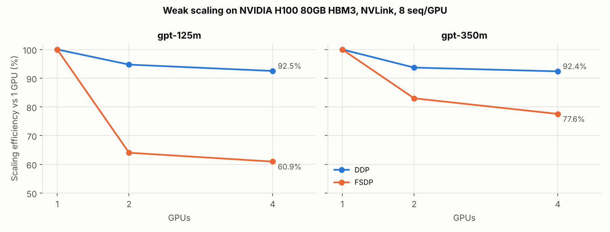
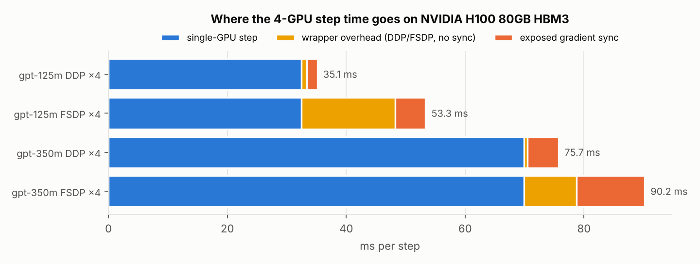
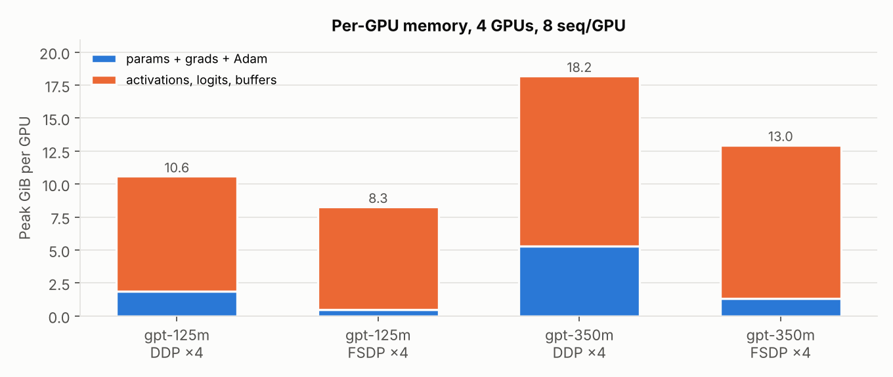
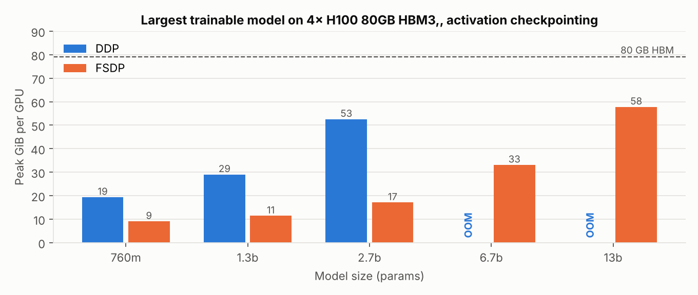

# Distributed LLM Training System

**Question:** How efficiently does GPT training scale across GPUs, and what limits it?

A GPT-2-style language model (125M and 350M parameters) trained with a single-GPU baseline, **DDP**, and **FSDP (PyTorch FSDP2 `fully_shard`)** on 1, 2 and 4 GPUs.

**Hardware:** 4× NVIDIA H100 80GB SXM (HBM3), full NVLink mesh (`NV18` between every GPU pair), PyTorch 2.8, CUDA 12.8. All numbers below were measured on this machine; raw data for every run is in `results/gpu/`.

## Results

> Achieved **92.5% scaling efficiency on 4 GPUs** with DDP; FSDP cut **per-GPU model-state memory 75%** (peak memory 29% for GPT-350M), enabling **4.85× larger models** (2.65B to 12.85B parameters).

| GPT-125M, 8 seq/GPU × 1024 tokens | Single GPU | DDP ×4 | FSDP ×4 |
|---|---|---|---|
| Step time | 32.5 ms | 35.1 ms | 53.3 ms |
| Throughput | 252K tok/s | 933K tok/s | 615K tok/s |
| **Scaling efficiency** | 100% | **92.5%** | 60.9% |
| Params + grads + Adam per GPU | 1.85 GiB | 1.85 GiB | **0.46 GiB (-75%)** |
| Peak memory per GPU | 10.1 GiB | 10.6 GiB | 8.3 GiB (-22%) |

| GPT-350M, 8 seq/GPU × 1024 tokens | Single GPU | DDP ×4 | FSDP ×4 |
|---|---|---|---|
| Step time | 69.9 ms | 75.7 ms | 90.2 ms |
| Throughput | 117K tok/s | 433K tok/s | 363K tok/s |
| **Scaling efficiency** | 100% | **92.4%** | 77.6% |
| Params + grads + Adam per GPU | 5.29 GiB | 5.29 GiB | **1.32 GiB (-75%)** |
| Peak memory per GPU | 18.2 GiB | 18.2 GiB | 13.0 GiB (-29%) |

| Largest trainable model on 4 GPUs (activation checkpointing) | DDP | FSDP |
|---|---|---|
| Largest that fit | 2.65B (52.6 GiB/GPU) | **12.85B (57.8 GiB/GPU)** |
| Next size up | 6.7B: out of memory | not tested; 13B was the top of the ladder |
| **Ratio** | | **4.85×** (lower bound; FSDP still had ~20 GiB/GPU free) |

Scaling efficiency is weak scaling: tokens/s on *p* GPUs ÷ (*p* × single-GPU tokens/s), with a fixed 8 sequences of 1024 tokens per GPU.

Also measured:

- **Interconnect:** NCCL all-reduce bus bandwidth 375.5 GB/s across 4 GPUs (340 GB/s across 2); all-gather 356 GB/s; reduce-scatter 359 GB/s.
- **Correctness:** DDP×4 and FSDP×4 finish 60 identical steps at the same loss (10.85485 vs 10.85485). In fp32, DDP and FSDP reproduce the single-device loss curve to within 2e-4 on 2 and 4 workers (`pytest`, 9 tests).
- **Single-GPU utilization:** 22% (125M) and 29% (350M) of H100 bf16 peak FLOPs, eager mode without `torch.compile`.



## What limits scaling

Each multi-GPU configuration was re-timed with gradient synchronization disabled. That splits the 4-GPU step into three parts:

| 4 GPUs | Single-GPU step | Wrapper overhead (no sync) | Exposed gradient sync | Total |
|---|---|---|---|---|
| DDP, 125M | 32.5 ms | +0.8 ms | +1.8 ms | 35.1 ms |
| FSDP, 125M | 32.5 ms | +15.8 ms | +5.0 ms | 53.3 ms |
| DDP, 350M | 69.9 ms | +0.6 ms | +5.2 ms | 75.7 ms |
| FSDP, 350M | 69.9 ms | +8.8 ms | +11.5 ms | 90.2 ms |



1. **On NVLink, communication barely limits DDP.** DDP all-reduces 500 MB (125M) to 1.4 GB (350M) of fp32 gradients every step. At 375 GB/s nearly all of it overlaps with the backward pass; only 1.8 to 5.2 ms per step is exposed, mostly the final gradient bucket, which can't start until backward finishes. DDP keeps 92% efficiency.
2. **FSDP is limited by fixed per-layer overhead, not bandwidth.** FSDP on one GPU, with no communication at all, is already 55% slower than plain training at 125M (50.5 vs 32.5 ms) and 18% slower at 350M. That cost comes from per-block hooks, gathering and freeing weights, and bf16 cast copies. Against its own 1-GPU run, FSDP scales well: 94.7% (125M) and 91.2% (350M). The overhead is roughly fixed per layer, so it shrinks relative to compute as layers get wider, and efficiency rises from 61% at 125M to 78% at 350M.
3. **Optimizer choice: 1.8× for FSDP.** The first FSDP runs used PyTorch's unfused (foreach) AdamW on FSDP's sharded tensors: 94.6 ms/step on 4 GPUs (34% efficiency). Switching to fused AdamW brought it to 53.3 ms. Gradient clipping on sharded tensors cost about 5 ms.
4. **FSDP buys memory, not speed, at this scale.** It cuts weight, gradient and Adam memory exactly 4× (16 bytes/param down to 4), but it doesn't shard activations or the logits buffer (about 3.8 GiB here with a 50,304-token vocabulary). So peak memory drops only 22 to 29% at 125M to 350M, while the largest trainable model grows 4.85× once weights dominate memory.




## Repository layout

```
dlt/
  model.py          GPT-2 architecture; configs tiny ... gpt-13b; analytical param count
  data.py           deterministic global-batch sampler (synthetic | stdlib bytes | uint16 .bin)
  train.py          single / DDP / FSDP2 trainer (torchrun), per-GPU memory, no-sync probe
  memory.py         per-GPU params/grads/optimizer bytes from live (sharded) tensors
  commbench.py      NCCL all-reduce / all-gather / reduce-scatter bandwidth benchmark
scripts/
  run_gpu_benchmarks.sh    full GPU study on a 4-GPU node
  summarize_measured.py    headline numbers -> results/gpu/summary.json
  plot_measured.py         figures/*.png
results/gpu/               every H100 run as JSON, GPU topology, NCCL bandwidth, full log
tests/                     loss equivalence vs single device, FSDP sharding, param count
```

## How to run

```bash
pip install -r requirements.txt
pytest -q tests/                              # ~1 min on CPU

# Full study on a 4-GPU node (~25 min on 4x H100; set GPU=A100-80GB on A100s)
GPU=H100-80GB bash scripts/run_gpu_benchmarks.sh

# Training directly
torchrun --nproc_per_node 4 -m dlt.train --strategy ddp  --model gpt-125m --micro-batch 8
torchrun --nproc_per_node 4 -m dlt.train --strategy fsdp --model gpt-350m --micro-batch 8
```

## Design notes

- **Exact equivalence by construction.** At step *s* every GPU derives the same global batch from `(seed, s)` and takes its own slice, so a single-device run with the full batch sees exactly the same tokens. That's what lets the tests compare loss curves directly.
- **FSDP2:** one unit per transformer block plus a root unit; `MixedPrecisionPolicy(param_dtype=bf16, reduce_dtype=fp32)`; `reshard_after_forward=True` (ZeRO-3); fused AdamW. `--meta-init` materializes only each GPU's shard, which is how the 12.85B model was initialized without full copies in host RAM.
- **DDP:** 25 MB gradient buckets, `gradient_as_bucket_view`, bf16 autocast over fp32 master weights, fused AdamW.
- **No-sync probe** (`--comm-probe-steps`): re-times steps with gradient synchronization disabled; the difference is exposed communication. For FSDP this disables only the reduce-scatter (all-gathers still run), so FSDP's all-gather cost is counted in "wrapper overhead".

## Limitations

- GPU throughput runs use synthetic tokens; there the loss values themselves are not meaningful, but loss parity between strategies is. Training on real text is covered by the CPU tests.
- Eager mode only; `torch.compile` would raise utilization and shrink FSDP's overhead share.
- Single node only (no multi-node, tensor or pipeline parallelism).
- The 4.85× max-model ratio is a lower bound because the model ladder stopped at 13B.
