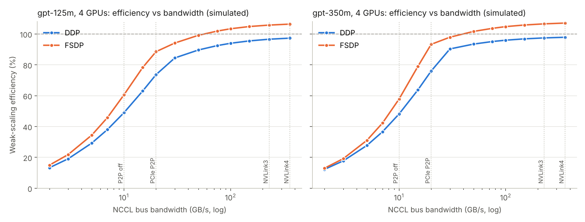
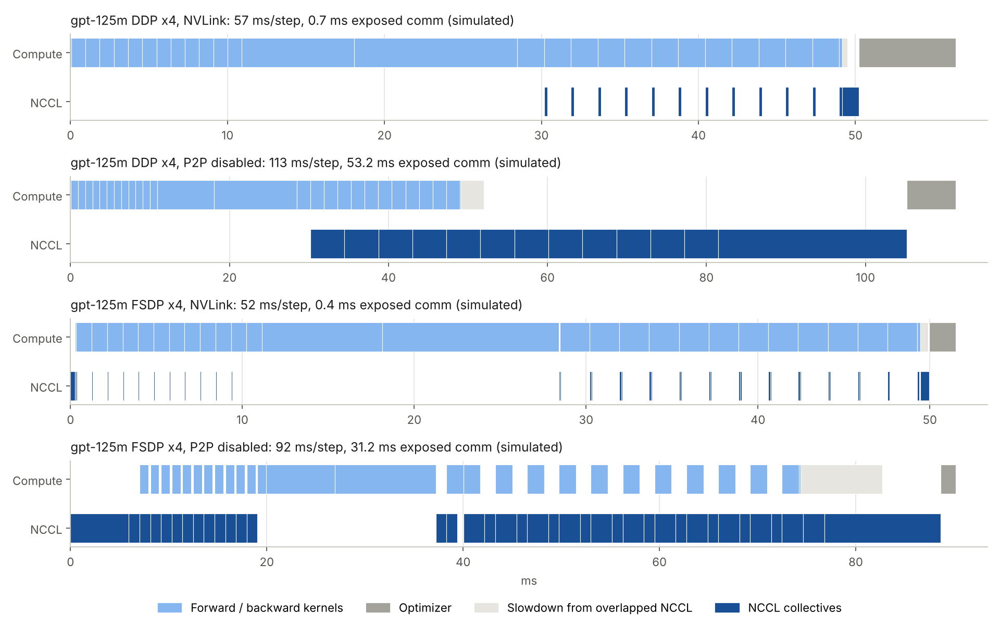

# Simulator: method, calibration, validation and experiments

Every number on this page is **Simulated** by `dlt/simulator.py` unless it is in a column marked **Measured (published)**, which are other people's measurements used only to calibrate and check the simulator.

Primary platform: **4x A100-SXM4-80GB, NVLink 3 (A100, NVSwitch)** (the ASU Sol job's target).

## Method

- **Compute:** every kernel of a training step (LayerNorm, 4 GEMMs, flash attention, GELU, residual adds, autocast casts, embedding, LM head, loss, grad clipping, AdamW) is costed with a roofline: `max(FLOPs / (peak x eta), bytes / (HBM x eta_mem), t_min)`.
- **Communication:** NCCL ring collectives, `alpha + 2(N-1)/N x bytes / busbw` (all-reduce) and `alpha + (N-1)/N x bytes / busbw` (all-gather, reduce-scatter).
- **Scheduling:** compute and NCCL run on separate streams. DDP all-reduces 25 MB fp32 buckets in reverse parameter order as gradients become ready; FSDP2 all-gathers each block in bf16 (prefetching one ahead), reduce-scatters fp32 gradients after each block's backward and shards the optimizer step. Overlapped communication slows compute (`interference`), and every sync waits for the slowest rank (`straggler_cv`).
- **Memory:** model state is exact (16 B/param, divided by N for FSDP, and checked against Measured CPU runs); activations follow Korthikanti et al. 2022 (34·s·b·h bytes/layer, no s² term with flash attention); logits b·s·V·10 bytes; plus autocast weight copies or FSDP's unsharded buffers.

## Parameters

| Parameter | Value | Basis |
|---|---|---|
| A100 peak / HBM | 312 TFLOPS / 1.56 to 2.04 TB/s | NVIDIA datasheet |
| H100 SXM peak / HBM | 989 TFLOPS / 3.35 TB/s | NVIDIA datasheet |
| NCCL bus bandwidth, NVLink 3 | 230 GB/s | ~85% of the ~270 GB/s P2P bandwidth measured on DGX A100 |
| NCCL bus bandwidth, NVLink 4 | 360 GB/s | ~370 GB/s/direction achieved (ASTRA-sim HGX-H100 validation) |
| NCCL bus bandwidth, P2P disabled | 10 GB/s | P2P-disabled copies measured 15 to 17 GB/s; ring through host is slower (assumed) |
| Per-collective latency | 15 to 30 us | assumed |
| GEMM efficiency `eta_gemm` | 0.632 | **calibrated** (one published anchor, below) |
| Flash-attention efficiency | 0.459 | same scale factor as eta_gemm |
| HBM efficiency | 0.75 | assumed |
| Overlap interference | 0.15 | assumed |
| Straggler jitter (CV) | 0.015 | assumed |
| AdamW traffic | 64 B/param | sum of the foreach kernels' reads and writes |
| Activations | 34·s·b·h B/layer | Korthikanti et al. 2022 |

## Calibration and validation

One published measurement sets `eta_gemm`. The rest are compared, never tuned to.

| Role | Setup | Metric | Measured (published) | Simulated | Error | Source |
|---|---|---|---|---|---|---|
| calibration | GPT-2 124M, 1x H100, PyTorch | MFU | 36.0% | 36.0% | +0.0 pts | [link](https://jjschwartz.github.io/blog/scaling-gpt2.html) |
| validation | GPT-2 124M, 8x H100 DDP, PyTorch | MFU | 33.0% | 35.1% | +2.1 pts | [link](https://jjschwartz.github.io/blog/scaling-gpt2.html) |
| validation | GPT-2 124M, 1x to 8x H100 DDP scaling efficiency (33% / 36% MFU) | efficiency | 91.7% | 97.4% | +5.8 pts | [link](https://jjschwartz.github.io/blog/scaling-gpt2.html) |
| validation | GPT-2 1.5B, 8x H100 DDP, PyTorch (micro-batch not reported; 8 x16 accum assumed) | MFU | 41.9% | 47.1% | +5.2 pts | [link](https://jjschwartz.github.io/blog/scaling-gpt2.html) |
| bound | GPT-2 124M, 1x A100 40GB PCIe, llm.c (hand-fused CUDA, fp16): simulated eager PyTorch should be lower | MFU | 49.0% | 42.0% | -7.0 pts | [link](https://github.com/karpathy/llm.c/discussions/481) |

Read this table as the simulator's error bar. Where the published runs used torch.compile, fused kernels or different batch sizes than assumed, part of the error is configuration, not physics.

## Platforms (simulated, micro-batch 8; T4 uses 4 and fp16)

| Platform | Model | GPUs | DDP efficiency | FSDP efficiency | DDP exposed comm (ms) | FSDP exposed comm (ms) |
|---|---|---|---|---|---|---|
| A100 80GB, NVLink | gpt-125m | 4 | 97% | 106% | 0.7 | 0.4 |
| A100 80GB, NVLink | gpt-350m | 4 | 97% | 107% | 0.3 | 0.5 |
| A100 80GB, PCIe P2P | gpt-125m | 4 | 74% | 89% | 15.8 | 6.6 |
| A100 80GB, PCIe P2P | gpt-350m | 4 | 76% | 93% | 32.2 | 6.1 |
| A100 80GB, P2P disabled | gpt-125m | 4 | 49% | 60% | 53.2 | 31.2 |
| A100 80GB, P2P disabled | gpt-350m | 4 | 48% | 58% | 138.8 | 84.9 |
| H100 80GB, NVLink | gpt-125m | 4 | 96% | 109% | 0.5 | 0.3 |
| H100 80GB, NVLink | gpt-350m | 4 | 97% | 111% | 0.2 | 0.3 |
| 2x T4 (Kaggle-style), PCIe Gen3 | gpt-125m | 2 | 77% | 94% | 42.9 | 17.2 |
| 2x T4 (Kaggle-style), PCIe Gen3 | gpt-350m | 2 | 78% | 98% | 91.7 | 15.7 |

## Bottleneck: the tied embedding gradient arrives last

`wte` is the first entry of `model.parameters()`, so DDP puts it in the **last** bucket, and because it is tied to the LM head its gradient is only complete after the embedding backward, the final kernel of the backward pass. Its all-reduce therefore can never overlap with compute.

| Model | Interconnect | wte size (fp32) | Share of params | Last-bucket all-reduce | Total exposed comm | Step | Efficiency | Efficiency with bf16 grad comm |
|---|---|---|---|---|---|---|---|---|
| gpt-125m | NVLink 3 (A100, NVSwitch) | 147 MB | 31% | 1.0 ms | 0.7 ms | 57 ms | 97% | 98% |
| gpt-125m | PCIe Gen4, P2P disabled (via host) | 147 MB | 31% | 23.7 ms | 53.2 ms | 113 ms | 49% | 74% |
| gpt-350m | NVLink 3 (A100, NVSwitch) | 196 MB | 15% | 1.4 ms | 0.3 ms | 146 ms | 97% | 98% |
| gpt-350m | PCIe Gen4, P2P disabled (via host) | 196 MB | 15% | 31.6 ms | 138.8 ms | 295 ms | 48% | 76% |

`--ddp-bf16-comm` (a real flag in train.py, using PyTorch's `bf16_compress_hook`) halves every all-reduce, including this one.

## DDP bucket size (gpt-350m, 4 GPUs)

| Interconnect | bucket_cap_mb | Efficiency | Exposed comm (ms) |
|---|---|---|---|
| NVLink 3 (A100, NVSwitch) | 1 | 97% | 0.3 |
| NVLink 3 (A100, NVSwitch) | 5 | 97% | 0.3 |
| NVLink 3 (A100, NVSwitch) | 25 | 97% | 0.3 |
| NVLink 3 (A100, NVSwitch) | 100 | 97% | 1.0 |
| PCIe Gen4, P2P disabled (via host) | 1 | 48% | 138.9 |
| PCIe Gen4, P2P disabled (via host) | 5 | 48% | 138.8 |
| PCIe Gen4, P2P disabled (via host) | 25 | 48% | 138.8 |
| PCIe Gen4, P2P disabled (via host) | 100 | 48% | 139.4 |

## FSDP: reshard after forward vs keep gathered (4 GPUs)

| Model | Interconnect | Efficiency (reshard) | Peak GiB (reshard) | Efficiency (keep) | Peak GiB (keep) |
|---|---|---|---|---|---|
| gpt-125m | NVLink 3 (A100, NVSwitch) | 106% | 7.0 | 107% | 7.1 |
| gpt-125m | PCIe Gen4, P2P disabled (via host) | 60% | 7.0 | 70% | 7.1 |
| gpt-350m | NVLink 3 (A100, NVSwitch) | 107% | 11.7 | 108% | 12.3 |
| gpt-350m | PCIe Gen4, P2P disabled (via host) | 58% | 11.7 | 73% | 12.3 |

## Largest trainable model (4 GPUs, micro-batch 1)

| GPU | Act. ckpt | DDP | FSDP | Ratio |
|---|---|---|---|---|
| A100-SXM4-40GB | no | gpt-1.3b (1.31B) | gpt-6.7b (6.65B) | 5.1x |
| A100-SXM4-40GB | yes | gpt-1.3b (1.31B) | gpt-6.7b (6.65B) | 5.1x |
| A100-SXM4-80GB | no | gpt-4b (4.23B) | gpt-13b (12.85B) | 3.0x |
| A100-SXM4-80GB | yes | gpt-4b (4.23B) | gpt-13b (12.85B) | 3.0x |

The ladder stops at 20B; an FSDP entry at the top of the ladder is a lower bound.

## Sensitivity (gpt-350m, 4x A100, NVLink)

Baseline simulated efficiency: DDP 97%, FSDP 107%.

| Assumption varied | Range | DDP efficiency | FSDP efficiency |
|---|---|---|---|
| NCCL bus bandwidth | x0.5 to x1.5 | 96% to 98% | 105% to 107% |
| GEMM efficiency | x0.8 to x1.2 | 98% to 97% | 105% to 108% |
| Overlap interference | x0.0 to x2.0 | 97% to 97% | 107% to 105% |
| Straggler jitter | x0.0 to x2.0 | 99% to 96% | 108% to 105% |
| Per-collective latency | x0.5 to x3.0 | 97% to 97% | 107% to 106% |

## Step timelines

## Limitations

- No kernel fusion or torch.compile modeled; eager PyTorch only.
- FSDP2's all-gather and reduce-scatter streams are modeled as one FIFO channel (pessimistic for FSDP).
- Bandwidth does not degrade for mid-size messages beyond the fixed latency term.
- CPU dispatch is modeled as a throughput limit, not as a timeline; Python-side stalls are not.
- Memory ignores allocator fragmentation beyond a fixed 1.5 GiB headroom.
- Every one of these is testable: run `bench/run_scaling.sh` on GPUs and `python bench/simulate.py --compare`.
