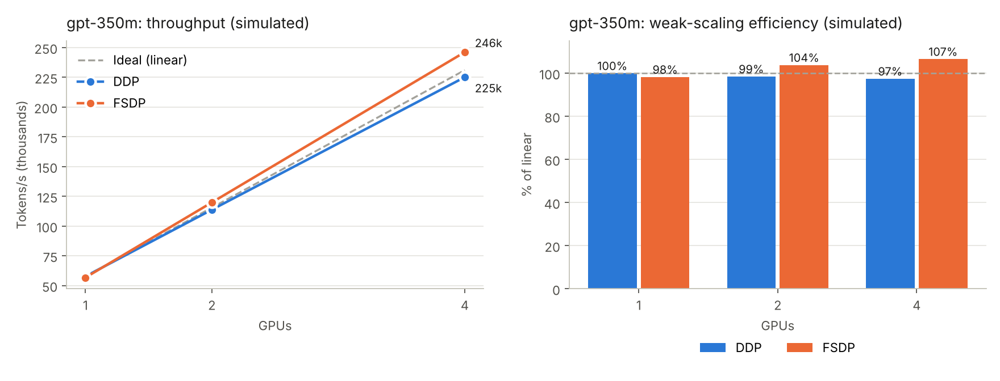
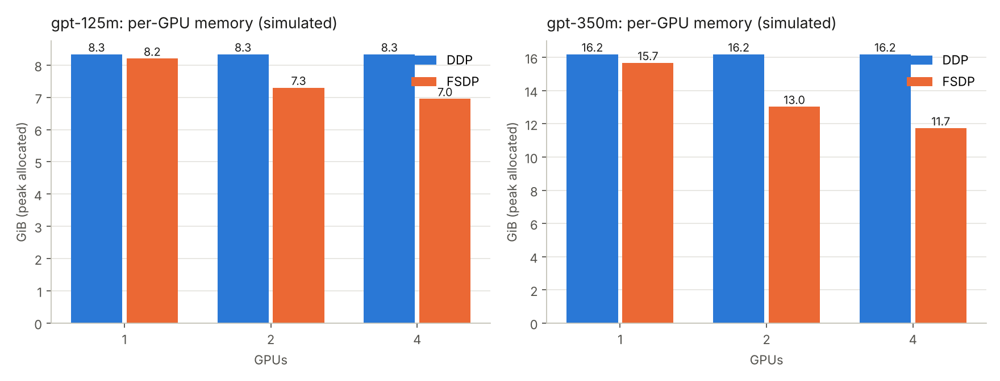
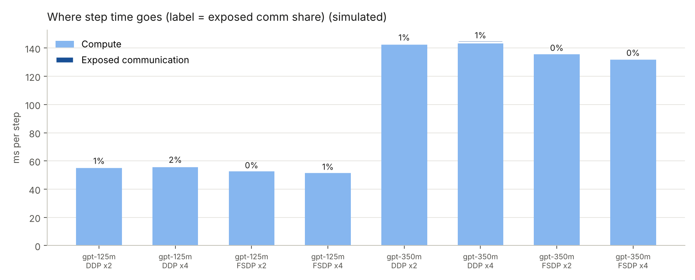
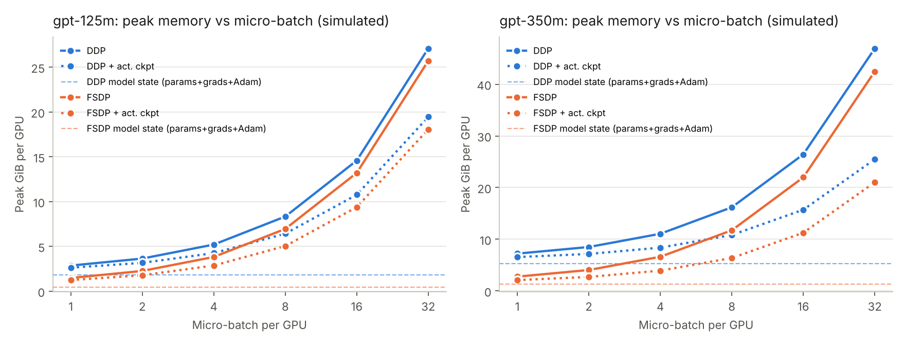

# Distributed LLM Training: Results

**Simulated:** 97% weak-scaling efficiency on 4 GPUs (DDP, gpt-350m), with FSDP at 1.09x DDP's throughput; FSDP cut per-GPU memory 27%, enabling 3.0x larger models (gpt-4b -> gpt-13b).

## Key findings (simulated)

- **gpt-125m, 4 GPUs:** DDP reached 97% weak-scaling efficiency vs 106% for FSDP (FSDP delivered 9% more throughput than DDP). Exposed communication was 1.1 ms/step for DDP vs 0.3 ms/step for FSDP; DDP hid 68% of its NCCL time behind compute, FSDP 92%.
- **gpt-350m, 4 GPUs:** DDP reached 97% weak-scaling efficiency vs 107% for FSDP (FSDP delivered 9% more throughput than DDP). Exposed communication was 1.5 ms/step for DDP vs 0.7 ms/step for FSDP; DDP hid 84% of its NCCL time behind compute, FSDP 93%.
- **Interconnect (gpt-125m, DDP x4):** disabling NVLink/P2P dropped efficiency from 97% to 49% (1.97x slower).
- **Interconnect (gpt-125m, FSDP x4):** disabling NVLink/P2P dropped efficiency from 106% to 60% (1.75x slower).
- **Interconnect (gpt-350m, DDP x4):** disabling NVLink/P2P dropped efficiency from 97% to 48% (2.03x slower).
- **Interconnect (gpt-350m, FSDP x4):** disabling NVLink/P2P dropped efficiency from 107% to 58% (1.85x slower).
- **Activation memory (gpt-125m, FSDP x4):** activations exceed sharded model state from micro-batch 1; at micro-batch 32 activations are 98% of peak.
- **Activation memory (gpt-125m, FSDP x4, ckpt):** activations exceed sharded model state from micro-batch 1; at micro-batch 32 activations are 97% of peak.
- **Activation memory (gpt-350m, FSDP x4):** activations exceed sharded model state from micro-batch 1; at micro-batch 32 activations are 97% of peak.
- **Activation memory (gpt-350m, FSDP x4, ckpt):** activations exceed sharded model state from micro-batch 2; at micro-batch 32 activations are 94% of peak.

## Weak scaling (fixed per-GPU batch)

| Model | Strategy | GPUs | Tokens/s | Step (ms) | Efficiency | MFU |
|---|---|---|---|---|---|---|
| gpt-125m | DDP | 1 | 148,030 | 55.3 | 100.0% | 40.6% |
| gpt-125m | DDP | 2 | 289,999 | 56.5 | 97.9% | 39.7% |
| gpt-125m | DDP | 4 | 572,179 | 57.3 | 96.6% | 39.2% |
| gpt-125m | FSDP | 1 | 146,673 | 55.9 | 99.1% | 40.2% |
| gpt-125m | FSDP | 2 | 306,870 | 53.4 | 103.6% | 42.0% |
| gpt-125m | FSDP | 4 | 626,416 | 52.3 | 105.8% | 42.9% |
| gpt-350m | DDP | 1 | 57,755 | 141.8 | 100.0% | 44.9% |
| gpt-350m | DDP | 2 | 113,814 | 144.0 | 98.5% | 44.2% |
| gpt-350m | DDP | 4 | 225,172 | 145.5 | 97.4% | 43.7% |
| gpt-350m | FSDP | 1 | 56,772 | 144.3 | 98.3% | 44.1% |
| gpt-350m | FSDP | 2 | 119,924 | 136.6 | 103.8% | 46.6% |
| gpt-350m | FSDP | 4 | 246,230 | 133.1 | 106.6% | 47.8% |

## Strong scaling (fixed global batch)

| Model | Strategy | GPUs | Speedup | Efficiency |
|---|---|---|---|---|
| gpt-125m | DDP | 1 | 1.00x | 100.0% |
| gpt-125m | DDP | 2 | 1.90x | 95.0% |
| gpt-125m | DDP | 4 | 3.48x | 87.1% |
| gpt-125m | FSDP | 1 | 1.00x | 99.7% |
| gpt-125m | FSDP | 2 | 1.96x | 97.9% |
| gpt-125m | FSDP | 4 | 3.81x | 95.3% |
| gpt-350m | DDP | 1 | 1.00x | 100.0% |
| gpt-350m | DDP | 2 | 1.90x | 95.0% |
| gpt-350m | DDP | 4 | 3.47x | 86.9% |
| gpt-350m | FSDP | 1 | 1.00x | 99.5% |
| gpt-350m | FSDP | 2 | 1.95x | 97.6% |
| gpt-350m | FSDP | 4 | 3.80x | 95.0% |

## Per-GPU memory

| Model | Strategy | GPUs | Simulated peak (GiB) | Model state (GiB) | Theory, 16 B/param (GiB) |
|---|---|---|---|---|---|
| gpt-125m | Single GPU | 1 | 8.02 | 1.85 | 1.85 |
| gpt-125m | DDP | 1 | 8.34 | 1.85 | 1.85 |
| gpt-125m | DDP | 2 | 8.34 | 1.85 | 1.85 |
| gpt-125m | DDP | 4 | 8.34 | 1.85 | 1.85 |
| gpt-125m | FSDP | 1 | 8.21 | 1.85 | 1.85 |
| gpt-125m | FSDP | 2 | 7.30 | 0.93 | 0.93 |
| gpt-125m | FSDP | 4 | 6.95 | 0.46 | 0.46 |
| gpt-350m | Single GPU | 1 | 15.06 | 5.28 | 5.28 |
| gpt-350m | DDP | 1 | 16.19 | 5.28 | 5.28 |
| gpt-350m | DDP | 2 | 16.19 | 5.28 | 5.28 |
| gpt-350m | DDP | 4 | 16.19 | 5.28 | 5.28 |
| gpt-350m | FSDP | 1 | 15.67 | 5.28 | 5.28 |
| gpt-350m | FSDP | 2 | 13.03 | 2.64 | 2.64 |
| gpt-350m | FSDP | 4 | 11.74 | 1.32 | 1.32 |

## Communication: how much is hidden behind backward?

| Model | Strategy | GPUs | Full step (ms) | Compute-only (ms) | Exposed comm | NCCL kernel time (ms) | Hidden |
|---|---|---|---|---|---|---|---|
| gpt-125m | DDP | 2 | 56.5 | 55.8 | 1.3% | 2.4 | 70% |
| gpt-125m | DDP | 4 | 57.3 | 56.2 | 1.9% | 3.4 | 68% |
| gpt-125m | FSDP | 2 | 53.4 | 53.2 | 0.3% | 2.6 | 94% |
| gpt-125m | FSDP | 4 | 52.3 | 52.0 | 0.5% | 3.6 | 92% |
| gpt-350m | DDP | 2 | 144.0 | 143.0 | 0.7% | 6.5 | 86% |
| gpt-350m | DDP | 4 | 145.5 | 144.0 | 1.1% | 9.6 | 84% |
| gpt-350m | FSDP | 2 | 136.6 | 136.2 | 0.3% | 7.0 | 94% |
| gpt-350m | FSDP | 4 | 133.1 | 132.4 | 0.5% | 10.0 | 93% |

## NVLink vs no-P2P

| Model | Strategy | GPUs | Efficiency (P2P on) | Efficiency (P2P off) | Slowdown |
|---|---|---|---|---|---|
| gpt-125m | DDP | 4 | 97% | 49% | 1.97x |
| gpt-125m | FSDP | 4 | 106% | 60% | 1.75x |
| gpt-350m | DDP | 4 | 97% | 48% | 2.03x |
| gpt-350m | FSDP | 4 | 107% | 58% | 1.85x |

## Where activation memory takes over

| Model | Strategy | GPUs | Act. ckpt | Activations > model state from micro-batch | Activation share at largest batch |
|---|---|---|---|---|---|
| gpt-125m | DDP | 4 | no | 4 | 93% |
| gpt-125m | DDP | 4 | yes | 4 | 90% |
| gpt-125m | FSDP | 4 | no | 1 | 98% |
| gpt-125m | FSDP | 4 | yes | 1 | 97% |
| gpt-350m | DDP | 4 | no | 4 | 89% |
| gpt-350m | DDP | 4 | yes | 8 | 79% |
| gpt-350m | FSDP | 4 | no | 1 | 97% |
| gpt-350m | FSDP | 4 | yes | 2 | 94% |

## Largest trainable model

On 4 GPUs (micro-batch 1): DDP fits **gpt-4b** (4,235M), FSDP fits **gpt-13b** (12,846M), **3.0x** larger.

